<p align="center">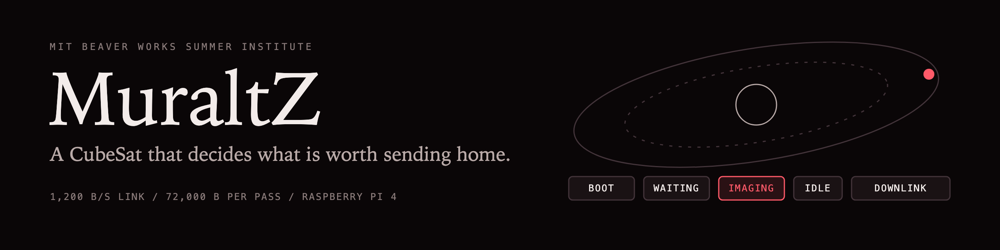</p>

<p align="center">
<a href="https://github.com/ayushg8/MIT-BWSI-Cubesat/actions/workflows/tests.yml"></a>


</p>

# MuraltZ CubeSat: flight software

A satellite cannot photograph everything and cannot send everything home, so it has to choose. This is the Raspberry Pi flight software I wrote for a CubeSat prototype at the MIT Beaver Works Summer Institute. The companion ground station is in [MIT-Cubesat-Ground-Control-Station](https://github.com/ayushg8/MIT-Cubesat-Ground-Control-Station).

**[Open the interactive site](https://ayushg8.github.io/MIT-BWSI-Cubesat/)** to click through the logic yourself.

### What it does

- **Points itself.** It only takes a photo when the camera faces the ground and is holding still.
- **Judges its own photos.** Every shot is checked on board for blur, brightness and shake, and bad ones are thrown away.
- **Picks what to send home.** The link is slow on purpose, so the best photos go first and the rest wait for the next pass.

<p align="center">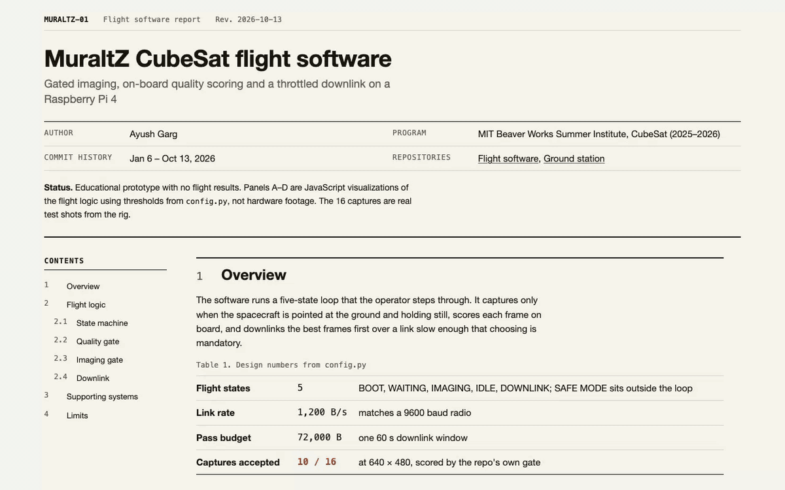</p>

*A recording of the [interactive site](https://ayushg8.github.io/MIT-BWSI-Cubesat/), which replays the flight logic with the same thresholds as `config.py`. It is not hardware footage.*

## Quality gate on real captures

Each photo is scored on blur, brightness and shake. The blur score is the Laplacian variance, a number that gets bigger the sharper the edges in the picture are. The gate wants at least 20.

The flight camera shoots 640 x 480, so I shrank the 16 test photos in `Images/` to that, saved them the way the camera code does, and ran the repo's own `QualityGate.score_image` on them. 10 of 16 pass. All 6 rejects are for blur.

<table>
<tr>
<td align="center" width="25%">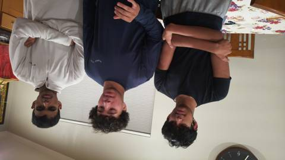<br><sub>accepted: sharp, variance 360.26 vs 20 needed</sub></td>
<td align="center" width="25%">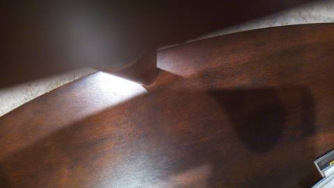<br><sub>accepted: sharp, variance 75.78 vs 20 needed</sub></td>
<td align="center" width="25%">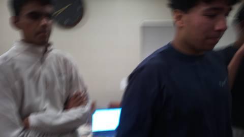<br><sub>rejected: too blurry, variance 13.26 below 20</sub></td>
<td align="center" width="25%">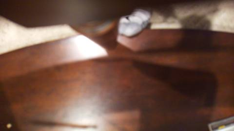<br><sub>rejected: too blurry, variance 5.74 below 20</sub></td>
</tr>
</table>

<details>
<summary>All 16 captures</summary>

<table>
<tr>
<td align="center"><br><sub><code>054319</code><br>accepted<br>variance 75.78</sub></td>
<td align="center"><br><sub><code>054605</code><br>rejected: blur<br>variance 0.54</sub></td>
<td align="center">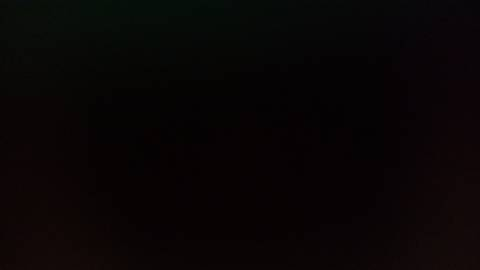<br><sub><code>055150</code><br>rejected: blur<br>variance 0.84</sub></td>
<td align="center">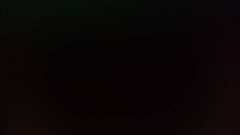<br><sub><code>055234</code><br>rejected: blur<br>variance 1.1</sub></td>
</tr>
<tr>
<td align="center"><br><sub><code>055240</code><br>rejected: blur<br>variance 5.74</sub></td>
<td align="center">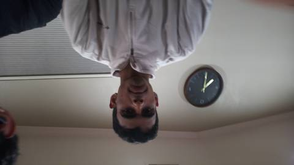<br><sub><code>193122</code><br>accepted<br>variance 56.87</sub></td>
<td align="center">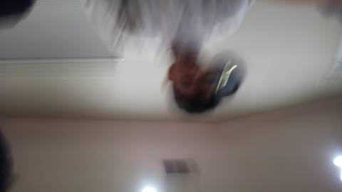<br><sub><code>193244</code><br>rejected: blur<br>variance 6.96</sub></td>
<td align="center"><br><sub><code>193548</code><br>accepted<br>variance 360.26</sub></td>
</tr>
<tr>
<td align="center">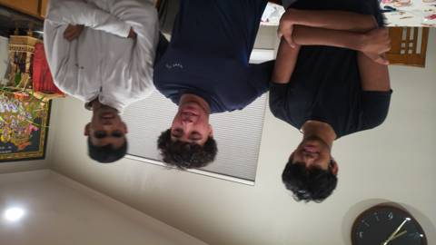<br><sub><code>193553</code><br>accepted<br>variance 297.94</sub></td>
<td align="center">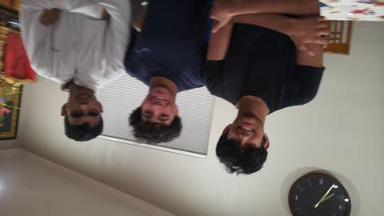<br><sub><code>193558</code><br>accepted<br>variance 124.45</sub></td>
<td align="center">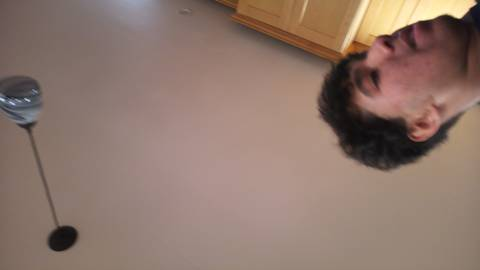<br><sub><code>193603</code><br>accepted<br>variance 20.91</sub></td>
<td align="center">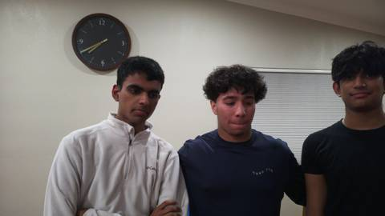<br><sub><code>194130</code><br>accepted<br>variance 189.11</sub></td>
</tr>
<tr>
<td align="center"><br><sub><code>194135</code><br>rejected: blur<br>variance 13.26</sub></td>
<td align="center">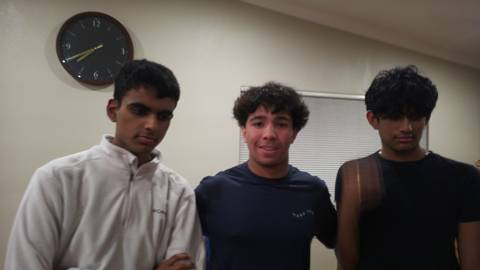<br><sub><code>194140</code><br>accepted<br>variance 79.09</sub></td>
<td align="center">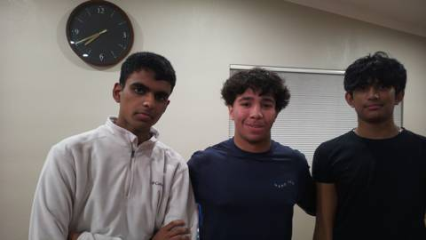<br><sub><code>194145</code><br>accepted<br>variance 187.53</sub></td>
<td align="center">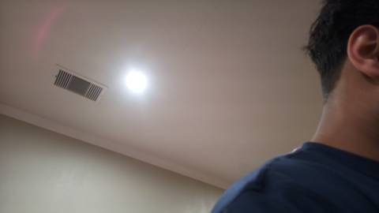<br><sub><code>194150</code><br>accepted<br>variance 22.41</sub></td>
</tr>
</table>

Gyro was set to 0.0 and novelty to 1.0 since no IMU or coverage grid was attached. Per-image numbers at both resolutions are in [`docs/data/captures.json`](docs/data/captures.json).

</details>

Scored at the full 4608 x 2592 instead, the same gate passes only 1 of 16, because variance shifts with resolution. That is why the 20 threshold is still a placeholder. The [site](https://ayushg8.github.io/MIT-BWSI-Cubesat/#gate) shows the per-check breakdown for each photo at both sizes.

## How it works

The flight loop is a state machine stepped by an operator (`cubesat_flight/main.py`). After boot it waits for a pass command, then runs IMAGING, IDLE and DOWNLINK and goes back to waiting.

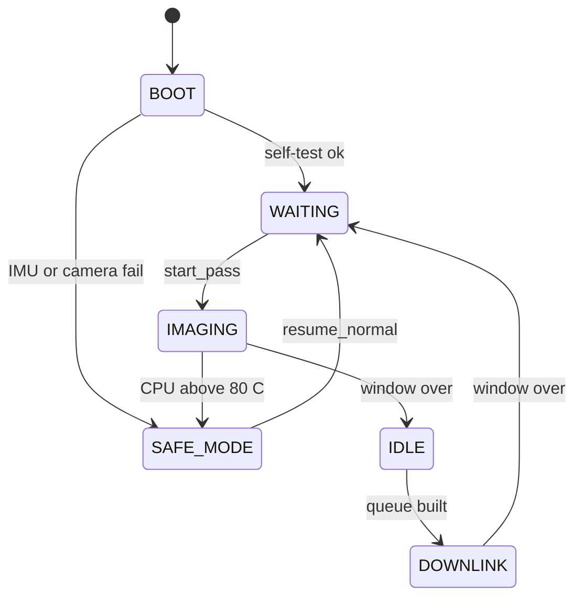

**BOOT** checks the IMU, takes a test photo that must decode as a JPEG, checks disk space and tries to reach the ground station. If the ground station is missing, the spacecraft logs autonomous mode and carries on.

**IMAGING** (`states/imaging.py`) reads the IMU every 3 seconds and shoots only when two things are true. First, nadir lock: nadir is the direction straight down at the ground, and the camera must point within 45 degrees of it. Once locked, it stays locked until the angle passes 55 degrees, which stops the camera flickering on and off at the edge. Second, the gyro must read under 1.0 rad/s. Each photo then goes through the quality gate (`processing/quality.py`), which checks blur, exposure, motion and novelty. A photo that survives gets a priority tier from how new its spot on an 8 x 8 coverage grid is, and one that fails gets a logged reason.

**IDLE** (`states/idle.py`) builds the send queue sorted by tier and score. Priority runs P1, P2, P3 from most to least important, and a P2 photo that has waited more than 2 passes drops to P3. IDLE also deletes the oldest P3 photos when storage fills up and applies any commands from the ground.

**DOWNLINK** (`states/downlink.py`, `comms/transfer.py`) sends telemetry, then photos highest priority first in 1,200-byte chunks with a real one-second sleep after each, until the 72,000-byte budget or the 60-second window runs out. Each photo carries an MD5 checksum; the ground station ACKs or NACKs it, and after three NACKs the photo is marked corrupt.

Three background pieces keep it alive. A watchdog thread restarts the process if the main loop stalls for 30 seconds. Thermal monitoring doubles the capture interval at 70 C and drops to safe mode at 80 C. A command listener takes validated JSON commands from the ground station over TCP. More in [docs/ARCHITECTURE.md](docs/ARCHITECTURE.md).

## Tech

- Python 3 on a Raspberry Pi 4
- LSM6DSO32 IMU over I2C (Adafruit CircuitPython), accelerometer and gyro
- Pi Camera Module 3 through `picamera2`
- OpenCV and NumPy for the quality gate and offline analysis, Flask for the inspection dashboard

## Repo layout

```
.
├── cubesat_flight/
│   ├── main.py            state machine loop
│   ├── config.py          every mission parameter
│   ├── protocol.py        contract shared with the ground station
│   ├── states/            boot, imaging, idle, downlink, safe_mode
│   ├── sensors/           IMU and camera wrappers
│   ├── processing/        quality gate, coverage grid, offline analysis
│   ├── comms/             throttled transfer, packets, command listener
│   ├── storage/           queue, image index, aging, cleanup
│   ├── utils/             watchdog, thermal, telemetry, logger
│   ├── dashboard/         offline Flask inspection app
│   └── test_*.py          processing tests and a hardware self-check
├── docs/
│   ├── index.html         interactive site (GitHub Pages)
│   ├── ARCHITECTURE.md    full design write-up
│   ├── data/captures.json quality-gate results for Images/
│   └── media/             banner, demo GIF, capture thumbnails
├── Images/                16 raw test captures
└── .github/workflows/     CI
```

## Running it

On the Pi:

```bash
sudo apt install -y python3-picamera2 python3-opencv
pip install -r requirements-hardware.txt
cd cubesat_flight
python test_hardware.py     # IMU / camera / thermal / storage / link self-check
python main.py              # then type: start_pass, cell R C, end_pass, status, shutdown
```

On a laptop, where only the offline analysis tests run:

```bash
pip install -r requirements.txt
cd cubesat_flight
export CUBESAT_DATA_ROOT="$(mktemp -d)"
python -m unittest -v test_processing.py
```

`GROUND_STATION_IP` and the data root can be overridden through environment variables (see `.env.example`).

## Limits

This is an educational prototype, and the numbers in this README are designed behavior from `config.py`, not flight results.

- The blur threshold of 20 is a placeholder that has not been calibrated on the real imaging surface. `config.py` says so too.
- There is no magnetometer, so pitch and roll are tracked but yaw is not.
- Wi-Fi stands in for a flight radio. The 1,200 byte/s throttle matches the rate of a 9600 baud UHF link.
- Terrain segmentation and route planning exist in the repo and run in the tests, but the flight loop does not use them.
- Camera height and power-draw values in `config.py` are still 0.0 placeholders.

| Setting | Value |
| --- | --- |
| Nadir lock / release | 45 / 55 degrees |
| Gyro stability gate | under 1.0 rad/s |
| Exposure gate (mean pixel) | 15 to 240 |
| Link rate | 1,200 bytes/s |
| Per-pass budget | 72,000 bytes in 60 s |
| Thermal throttle / safe mode | 70 / 80 C |
