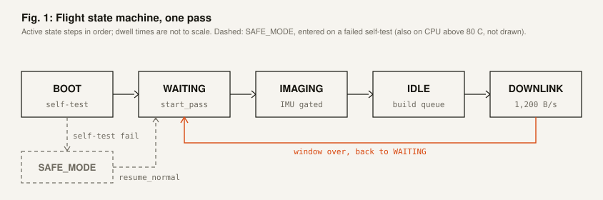
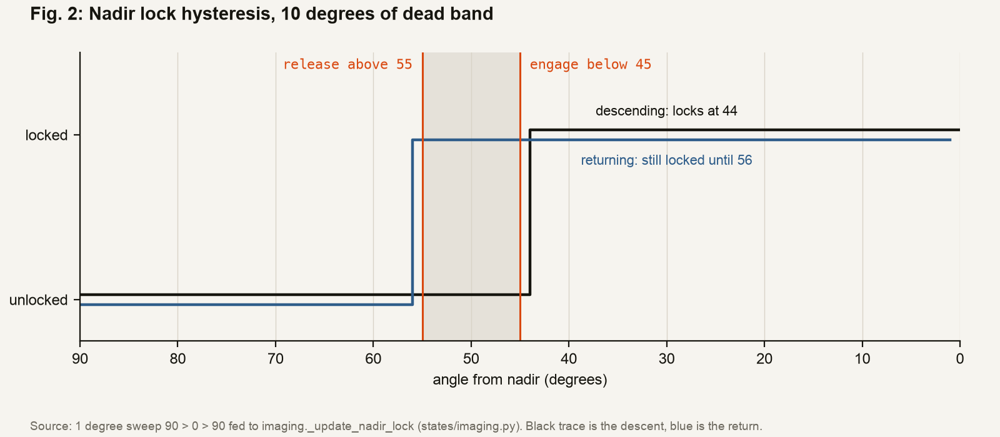
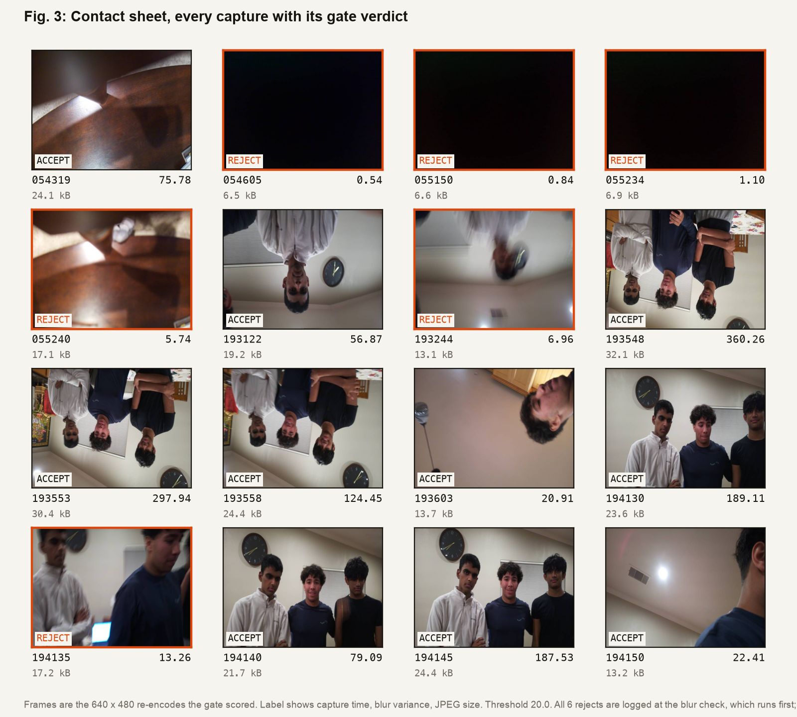
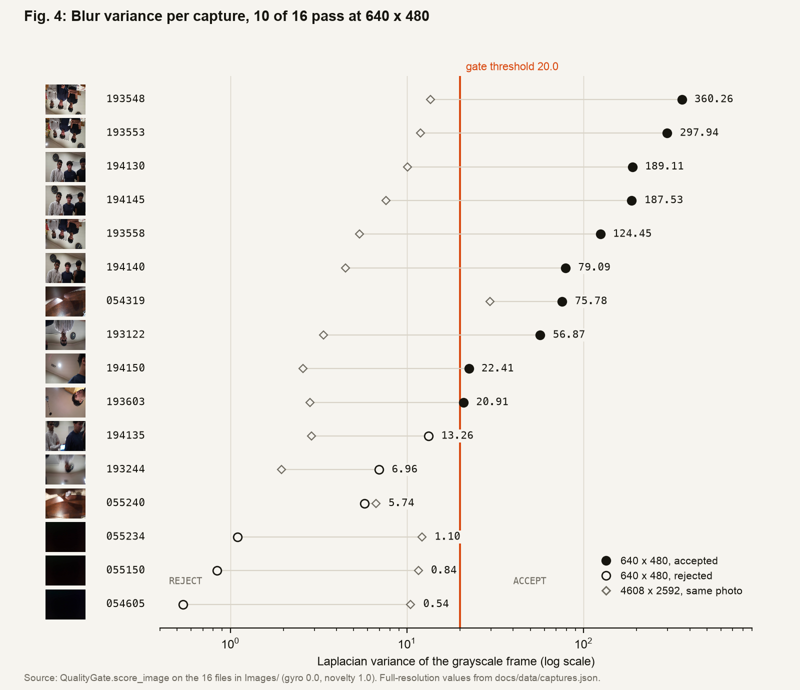
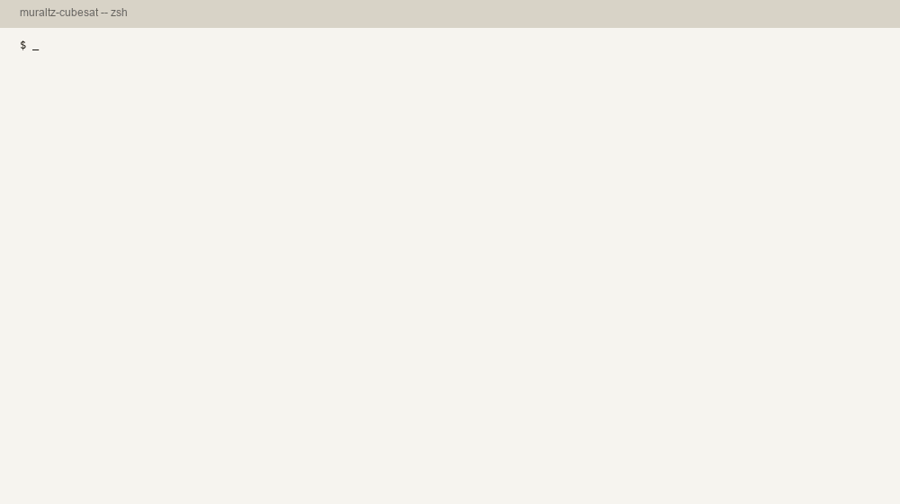
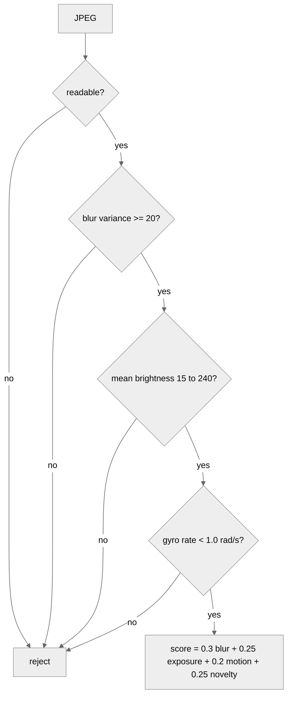
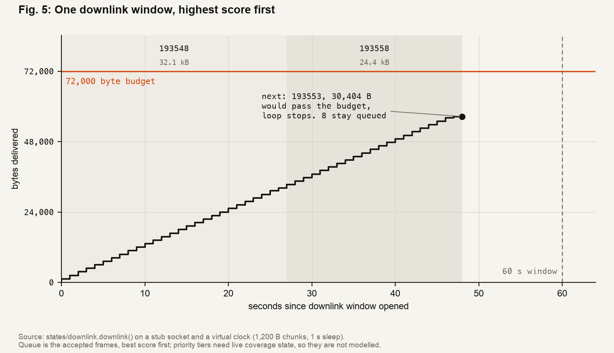
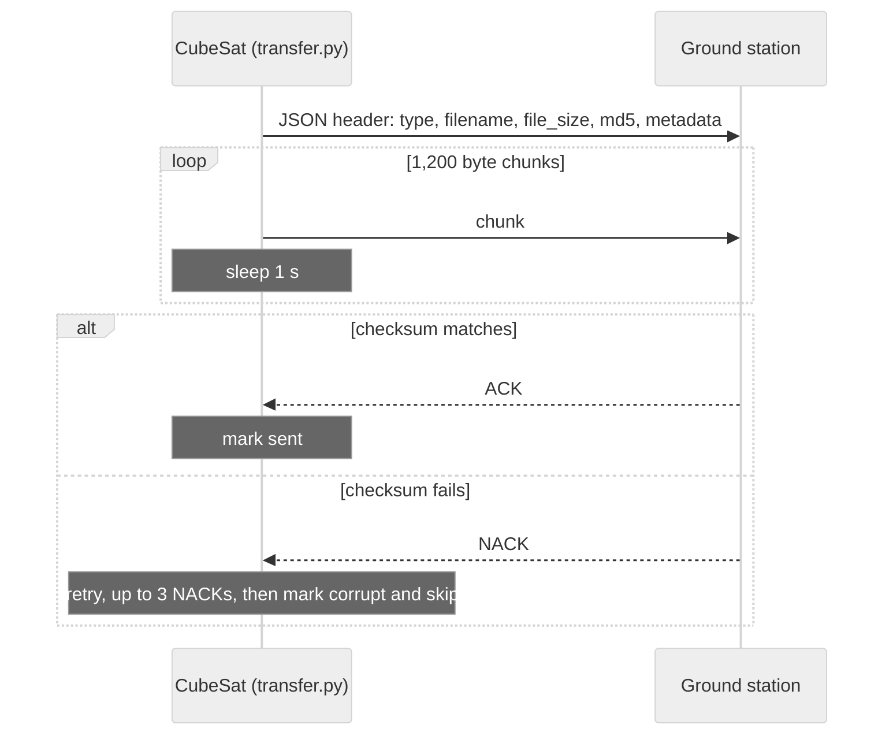
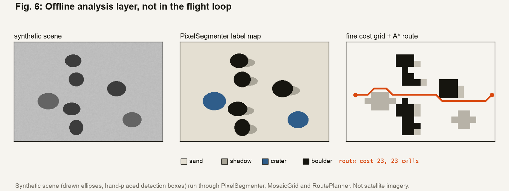

<p align="center"></p>

<p align="center">
<a href="https://github.com/ayushg8/MIT-BWSI-Cubesat/actions/workflows/tests.yml"></a>


</p>

# MuraltZ CubeSat: flight software

Raspberry Pi flight software for the MuraltZ CubeSat prototype, built at the MIT Beaver Works Summer Institute. The loop points the camera, shoots only when the IMU says it is steady and facing the ground, scores each photo on board, and sends the best ones home within a fixed byte budget. The companion ground station is in [MIT-Cubesat-Ground-Control-Station](https://github.com/ayushg8/MIT-Cubesat-Ground-Control-Station).

**[Open the interactive site](https://ayushg8.github.io/MIT-BWSI-Cubesat/)** to click through the logic yourself.

### What it does

- It only takes a photo when the camera faces the ground and is holding still.
- Every shot is checked on board for blur, brightness and shake, and bad ones are thrown away.
- The best photos go first, and the rest wait for the next pass.

<p align="center"></p>

*A recording of the [interactive site](https://ayushg8.github.io/MIT-BWSI-Cubesat/), which replays the flight logic with the same thresholds as `config.py`. It is not hardware footage.*

## How it works

<p align="center"></p>

The flight loop is a state machine stepped by an operator (`cubesat_flight/main.py`). After boot it waits for a pass command, then runs IMAGING, IDLE and DOWNLINK and goes back to waiting. Fig. 1 is an animation, so the active state moves by itself.

<details>
<summary>What each state does</summary>

**BOOT** checks the IMU, takes a test photo that must decode as a JPEG, checks disk space and tries to reach the ground station. If the ground station is missing, the spacecraft logs autonomous mode and carries on.

**IMAGING** (`states/imaging.py`) reads the IMU every 3 seconds and shoots only when the camera is near nadir and the gyro reads under 1.0 rad/s. Each photo goes through the quality gate, and a photo that survives gets a priority tier from how new its spot on an 8 x 8 coverage grid is.

**IDLE** (`states/idle.py`) builds the send queue sorted by tier and score. Priority runs P1, P2, P3 from most to least important, and a P2 photo that has waited more than 2 passes drops to P3. IDLE also deletes the oldest P3 photos when storage fills up and applies any commands from the ground.

**DOWNLINK** (`states/downlink.py`, `comms/transfer.py`) sends telemetry, then photos highest priority first, until the byte budget or the time window runs out.

Three background pieces keep it alive. A watchdog thread restarts the process if the main loop stalls for 30 seconds. Thermal monitoring doubles the capture interval at 70 C and drops to safe mode at 80 C. A command listener takes validated JSON commands from the ground station over TCP. More in [docs/ARCHITECTURE.md](docs/ARCHITECTURE.md).

</details>

## Pointing: nadir lock

<p align="center"></p>

Nadir is straight down at the ground. The camera locks when it points within 45 degrees of nadir and lets go only past 55, so a camera hovering near 50 does not flicker on and off. Fig. 2 feeds a 1 degree sweep through the real `_update_nadir_lock`.

## Quality gate on real captures

<p align="center"></p>

Each photo is scored on blur, brightness and shake. The blur score is the Laplacian variance, which gets bigger the sharper the edges are, and the gate wants at least 20. I shrank the 16 photos in `Images/` to the flight camera's 640 x 480, saved them the way the camera code does, and ran the repo's own `QualityGate.score_image`. 10 of 16 pass. The 6 rejects are all logged at the blur check, which runs first; 3 of them are near-black frames (mean brightness under 7) that would also fail the exposure minimum of 15.

<p align="center"></p>

The faint diamonds in Fig. 4 are the same photos at the full 4608 x 2592. Scored there, the gate passes only 1 of 16, because variance shifts with resolution. That is why 20 is still a placeholder. The [site](https://ayushg8.github.io/MIT-BWSI-Cubesat/#gate) shows the per-check breakdown for each photo.

<p align="center"></p>

The terminal output above is a real run of `docs/figures/gate_report.py` and `python -m unittest -v test_processing.py`, replayed as frames.

<details>
<summary>How the gate decides</summary>



Gyro was set to 0.0 and novelty to 1.0 for these runs, since no IMU or coverage grid was attached. Per-image numbers at both resolutions are in [`docs/data/captures.json`](docs/data/captures.json).

</details>

## Downlink

<p align="center"></p>

The link moves 1,200 bytes per second for a 60 second window, so a pass carries 72,000 bytes at most. Fig. 5 runs the real `downlink()` loop against a stub socket on a virtual clock, with the accepted captures queued best score first. Two photos go out, and the third would cross the budget, so it waits for the next pass.



## Offline analysis layer

<p align="center"></p>

Terrain segmentation, the cost grid and A* route planning live in `processing/` and run in the tests, but the flight loop does not call them. Fig. 6 uses a synthetic scene because the indoor captures have no terrain to segment; the detection boxes are placed by hand.

## Tech

- Python 3 on a Raspberry Pi 4
- LSM6DSO32 IMU over I2C (Adafruit CircuitPython), accelerometer and gyro
- Pi Camera Module 3 through `picamera2`
- OpenCV and NumPy for the quality gate and offline analysis, Flask for the inspection dashboard

<details>
<summary>Repo layout</summary>

```
.
├── cubesat_flight/
│   ├── main.py            state machine loop
│   ├── config.py          every mission parameter
│   ├── protocol.py        contract shared with the ground station
│   ├── states/            boot, imaging, idle, downlink, safe_mode
│   ├── sensors/           IMU and camera wrappers
│   ├── processing/        quality gate, coverage grid, offline analysis
│   ├── comms/             throttled transfer, packets, command listener
│   ├── storage/           queue, image index, aging, cleanup
│   ├── utils/             watchdog, thermal, telemetry, logger
│   ├── dashboard/         offline Flask inspection app
│   └── test_*.py          processing tests and a hardware self-check
├── docs/
│   ├── index.html         interactive site (GitHub Pages)
│   ├── ARCHITECTURE.md    full design write-up
│   ├── data/captures.json quality-gate results for Images/
│   ├── figures/           scripts that generate every figure above
│   └── media/             banner, demo GIF, figures, capture thumbnails
├── Images/                16 raw test captures
└── .github/workflows/     CI
```

</details>

## Running it

On the Pi:

```bash
sudo apt install -y python3-picamera2 python3-opencv
pip install -r requirements-hardware.txt
cd cubesat_flight
python test_hardware.py     # IMU / camera / thermal / storage / link self-check
python main.py              # then type: start_pass, cell R C, end_pass, status, shutdown
```

On a laptop, where only the offline analysis tests run:

```bash
pip install -r requirements.txt
cd cubesat_flight
export CUBESAT_DATA_ROOT="$(mktemp -d)"
python -m unittest -v test_processing.py
```

To rebuild the figures (needs Python 3.11 or newer and `pip install matplotlib`):

```bash
python docs/figures/make_figures.py
```

`GROUND_STATION_IP` and the data root can be overridden through environment variables (see `.env.example`).

## Limits

This is an educational prototype, and the numbers here are designed behavior from `config.py`, not flight results.

- The blur threshold of 20 is a placeholder that has not been calibrated on the real imaging surface.
- There is no magnetometer, so pitch and roll are tracked but yaw is not.
- Wi-Fi stands in for a flight radio. The 1,200 byte/s throttle matches a 9600 baud UHF link.
- Camera height and power-draw values in `config.py` are still 0.0 placeholders.

| Setting | Value |
| --- | --- |
| Nadir lock / release | 45 / 55 degrees |
| Gyro stability gate | under 1.0 rad/s |
| Exposure gate (mean pixel) | 15 to 240 |
| Link rate | 1,200 bytes/s |
| Per-pass budget | 72,000 bytes in 60 s |
| Thermal throttle / safe mode | 70 / 80 C |
